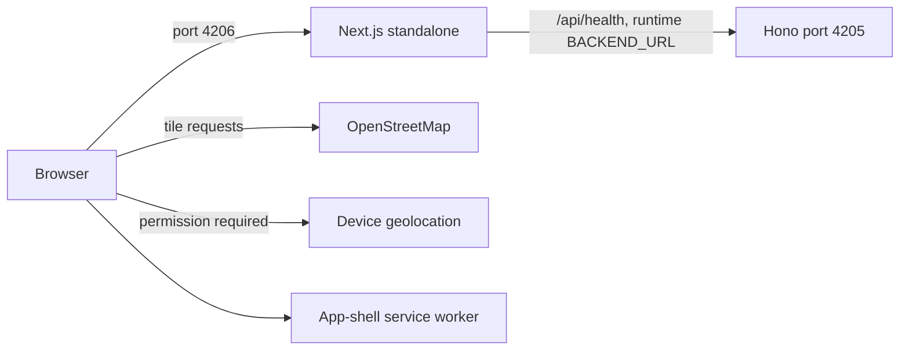

# OpenRoad

A Next.js and TypeScript map PWA built with Leaflet and OpenStreetMap.

Stage one supports map browsing, destination pins, location permission, position accuracy, recentering, installation, and an offline application shell. Driving route previews show road geometry, distance and estimated duration.

## Run locally

Use Node.js 24 or newer and pnpm 11.13.1, matching Mokara.

```sh
pnpm install --frozen-lockfile
pnpm dev
```

Frontend: http://127.0.0.1:4206. Backend: http://127.0.0.1:4205/health. Geolocation requires HTTPS or a browser-trusted loopback origin. Location starts only after a button press. No coordinates are persisted or sent to application analytics.

## Verify

```sh
pnpm test
pnpm typecheck
pnpm build
pnpm release:check
```

The frontend builds Next.js standalone output and generates a versioned service worker in its public directory. Run the Docker stack below to check the production app and offline shell. The service worker is disabled in development.

## Map provider

`packages/frontend/public/map-config.json` is the single source for tile URL, attribution, zoom limits, and initial view. The browser fetches it at runtime. Keep provider attribution visible. Standard OpenStreetMap tiles are configured for this prototype. Read https://operations.osmfoundation.org/policies/tiles/ before public launch and select a provider appropriate to expected traffic. Tiles are not prefetched or cached by our service worker.

Curated Kuala Lumpur destinations are local sample places, not a search API. Dropping a pin uses its coordinates without reverse geocoding.

## PWA limits

After a successful online visit, the production app can launch offline. Unloaded map tiles need connectivity. Tracking pauses while the page is hidden and resumes only if previously enabled. There is no background navigation, trip history, or offline route calculation.

## Workspace and architecture

```text
packages/
  frontend/          # Next.js, Leaflet, geolocation and PWA
    src/app/         # Pages and same-origin API endpoints
    src/features/    # Map, location and navigation modules
    src/pwa/         # Install and update controls
    public/          # Map configuration, icons and generated worker
    scripts/         # Worker and icon generation
    tests/           # Location lifecycle and config regression tests
    Dockerfile
  backend/           # Hono HTTP service
    src/             # Application routes and server entry point
    test/            # HTTP route tests
    Dockerfile
scripts/check-release.mjs
pnpm-workspace.yaml
pnpm-lock.yaml
docker-compose.yml
.github/workflows/ci.yml
.github/workflows/release.yml
```



The backend exposes `/health` and `POST /routes`. Route previews use OSRM and do not include live traffic or turn-by-turn guidance.
The frontend proxies `/api/health` using runtime `BACKEND_URL`, so container images
are independent of the deployment hostname. Geolocation remains allowed for the
same origin. The worker excludes API responses and external tiles.

## Local Docker images

```sh
pnpm docker:build
pnpm docker:up
curl --fail http://127.0.0.1:4205/health
curl --fail http://127.0.0.1:4206/api/health
pnpm test:smoke
# Stop this stack when finished:
pnpm docker:down
```

Compose builds `openroad-backend:0.1.0` and `openroad-frontend:0.1.0`. Both run as
non-root users and have health checks. Host ports bind to loopback by default.
For hosting, provide HTTPS through your reverse proxy and set frontend
`BACKEND_URL` to the backend service URL. Environment examples live in each package.

## Main and release images

The prepared workflows follow Mokara's GHCR setup. After an explicitly authorized
push to a configured GitHub repository, `main` runs tests, type checks, builds,
container health checks and a frontend-to-backend smoke test before publishing
`ghcr.io/<repository-owner>/openroad-frontend:main` and the corresponding backend
image, plus immutable `sha-<commit>` tags. Stable `vX.Y.Z` tags publish version,
major.minor and `latest` tags. Tags must match every workspace manifest and point
to a commit reachable from main. Prerelease versions fail the gate.

Keep root and package versions synchronized; run `pnpm release:check` before
release. GitHub Actions uses `GITHUB_TOKEN` with package-write permission.
No registry credentials belong in the source. Local builds do not publish images.

Application source is MIT licensed. Map data and dependencies retain their own
licenses. See THIRD_PARTY_NOTICES.md.

## Driving route previews

Select a destination and calculate a route from a fresh device location. If GPS is
unavailable, select a pin or sample place, choose **Use selected pin as start**,
then select the destination and calculate. Changing either selection clears the
previous route and cancels any pending browser request.

`POST /api/routes` proxies to backend `POST /routes` with JSON
`{ "origin": { "lat": 3.1486, "lng": 101.6935 }, "destination": { "lat": 3.155, "lng": 101.713 } }`.
The response has `points` as named lat/lng objects, `distanceMeters`, and
`durationSeconds`. Input and response coordinates are validated. Requests have
a 2 KiB body limit, a 12-second provider timeout, no-store responses, and a
process-wide one-request-per-1.1-second budget for this prototype. The frontend
proxy has a 15-second deadline. This is not a distributed production rate limiter.

The local default is the public OSRM demo at https://router.project-osrm.org.
Both route points are sent there only when Calculate route is pressed. OpenRoad
does not persist or log route bodies. The provider may have its own access logs.
Use `OSRM_URL` for a self-hosted or dedicated compatible service before public
launch, and review the provider usage policy. Public demo uptime is not guaranteed.
No location history, analytics database, search API or automatic rerouting is added.
